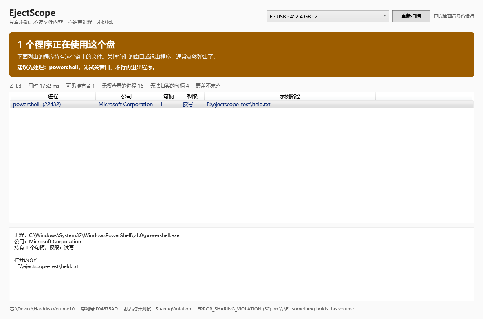

# EjectScope

> U 盘弹出失败的时候，告诉你到底是谁握着它、它重不重要、现在拔会丢什么。

**只看不动**：不读文件内容、不修改任何文件、不结束任何进程、不联网、不自启、不注入。

> 仓库名 `WhoholdsMy-USB`，产品名 `EjectScope`。



---

## 为什么会有这个工具

Windows 提示「设备正在使用中，无法弹出」，但资源管理器明明打得开。于是大多数人做两件事之一：

- 硬拔。如果此时有程序正在写盘，轻则丢几个文件，重则文件系统需要修复。
- 或者认定 U 盘/接口坏了，白折腾半天。

EjectScope 试着把这个问题变成三个能回答的问题：

1. **谁在用？** 哪个进程、什么公司、把哪个文件打开着。
2. **它在写吗？** 只读占用和正在写入，处置方式完全不同。
3. **我该等、该关，还是该怀疑硬件？**

## 现在能做什么（v0.1，只读）

- 列出占用目标盘的每个进程：PID、公司名、句柄数、读/写权限、它具体打开的文件路径。
- 判断是否**正在写入**：有写句柄时，对相关文件做 1.5 秒观察窗口，看大小或修改时间是否变化。
- **卷级独占打开测试**：区分「有程序占着」和「没有可归因的进程，问题在驱动或硬件层」。
- **诚实的覆盖率**：多少个进程无权查看、多少个句柄读不到归属，全部计数并显示；覆盖不全时明确说「无法确认」，而不是假装没事。
- 同一引擎的 CLI 版本，方便脚本化排查和复现。

## 现在刻意不做的事

- 不结束进程、不关闭句柄、不卸载卷。处置功能规划在 v0.2；「强制卸载卷」这一档已经从设计里删除——想拔盘的人自己会拔。
- 不读取文件内容（不做全文搜索、不算哈希、不预览）——它需要的只是句柄元数据。
- 不安装服务、不写注册表自启、不建计划任务。
- 不联网：没有更新检查、没有遥测、没有崩溃上报。
- 不注入进程、不做 API hook。它请求的权限只用来「看」。

## 怎么用

从 Releases 下载 `EjectScope.exe`，双击即可。不需要安装。

- 需要 **.NET Framework 4.8**：Windows 10 1903 之后和 Windows 11 自带。更早的系统可装一次 4.8 运行时。
- 默认以普通权限启动（`asInvoker`）。窗口右上角会提示当前权限；点「以管理员身份重启」能看到更多系统进程持有的句柄。
- 少数受保护进程（PPL，例如 `System`、`csrss`、部分安全软件）即使管理员也打不开，它们会以「无权查看的进程」计数出现，而不会被悄悄忽略。

### 命令行

```
ejectscope-cli.exe E:           诊断 E:
ejectscope-cli.exe --list       列出可诊断的卷，标注总线类型
ejectscope-cli.exe --selftest   自检：自己开一个文件，再把自己找出来
ejectscope-cli.exe --dump-types 打印句柄类型索引的解析情况（排障用）
```

退出码：`0` 正常，`2` 用法错误，`3` 检测到正在写入。

## 结论怎么读

| 结论 | 颜色 | 含义 | 建议 |
| --- | --- | --- | --- |
| 可以正常弹出 | 绿 | 句柄扫描完整，卷级独占打开也成功 | 正常弹出 |
| N 个程序正在使用 | 琥珀 | 有可见的文件句柄 | 先关窗口，再考虑退出程序 |
| 正在写入数据 | 红 | 写句柄 + 观察窗口内文件确实变大 | 等它写完，**不要拔** |
| 没有程序占用 | 蓝 | 没有可归因进程，但卷被独占打开拒绝 | 查硬件：换口、换线、供电、驱动 |
| 无法确认 | 灰 | 覆盖率不足 | 以管理员重跑；仍不足就说明有驱动层持有者 |

颜色不是装饰：红色出现时，界面不会提供任何「立即拔除」之类的一键操作。

## 它是怎么知道的

五层，逐层缩小范围：

1. **卷识别**：`GetDriveTypeW` 会把 USB 移动硬盘报成「本地磁盘」，所以还要用 `IOCTL_STORAGE_QUERY_PROPERTY` 读总线类型，只有 `BusTypeUsb` 才算 USB。
2. **盘符 → NT 设备名**：`QueryDosDeviceW("E:")` 得到 `\Device\HarddiskVolumeN`，这是后面所有匹配的地基。
3. **卷标的快速通道**：Restart Manager（`RmGetList`）不需要管理员，能给出文件级占用者；但对卷根目录不一定有结果，所以只作为第一层信号。
4. **全系统句柄枚举**：`NtQuerySystemInformation(SystemExtendedHandleInformation)` 遍历所有句柄，按卷序列号（文件句柄）或 NT 路径（目录、卷句柄）匹配到目标盘。
5. **卷级独占打开**：以 `GENERIC_READ|GENERIC_WRITE`、共享模式 0 打开 `\\.\E:`，用返回值区分「无人占用」和「被占用」。

两个必须踩过才知道的坑，代码里都有对应处理：

- **对命名管道调用 `NtQueryObject` 会永久阻塞**（Sysinternals `handle.exe` 的经典问题）。名字查询因此放在独立线程里，带超时；超时就标记「无法确认」，绝不主线程上硬等。
- **受保护进程打不开**。这一步失败必须计数并让用户看见，否则覆盖率会撒谎。

## 已知限制

- 驱动层/杀软过滤驱动持有的锁只有部分可见；`FILE_TYPE_DISK` 之外的对象不参与匹配。
- 覆盖率受权限影响：普通权限下能看到十几到几十个「无权查看的进程」。
- 目前只在 Windows 11（10.0.26200）上实测过；NT 结构体在不同版本间是稳定的，但类型索引需要运行时识别，`--dump-types` 就是为此准备的。
- 扫描是快照，不是实时：期间有进程开/关文件会漏。
- 句柄量大时耗时上升：本机约 12–18 万句柄，一次扫描 1–4 秒。

## 安全与隐私

三条硬性不变量写在 `docs/DESIGN.md` 里，并有对应的实现检查：

1. 永不读取文件内容（只查元数据）。
2. 永不修改、删除、重命名用户的文件。
3. 覆盖率不足时，禁止输出「可以安全拔出」。

威胁模型、供应链与漏洞报告方式见 [SECURITY.md](SECURITY.md)。

## 自己构建

零安装（推荐，用 Windows 自带的 C# 编译器）：

```powershell
powershell -ExecutionPolicy Bypass -File build.ps1
# build\EjectScope.exe  build\ejectscope-cli.exe
```

安装过 .NET SDK 也可以用 SDK 构建：

```powershell
dotnet build src/EjectScope.App/EjectScope.App.csproj -c Release
```

源码保持 **C# 5** 语法（系统自带 `csc.exe` 只支持到 5），这样同一份代码两条构建路径都能过。

需要一张窗口截图时：

```powershell
.\build\EjectScope.exe --screenshot out.png
```

## 路线图

- **v0.2**：安全处置（档 0 刷缓存 → 档 1 关窗口 → 档 2 请求退出 → 档 3 暂停服务/同步 → 档 4 结束进程，有写句柄时必须二次确认）。
- **v1.0**：GitHub Actions 构建、可复现构建校验、代码签名、SBOM。

## 贡献与许可

见 [CONTRIBUTING.md](CONTRIBUTING.md)。代码以 [MIT](LICENSE) 许可发布。
